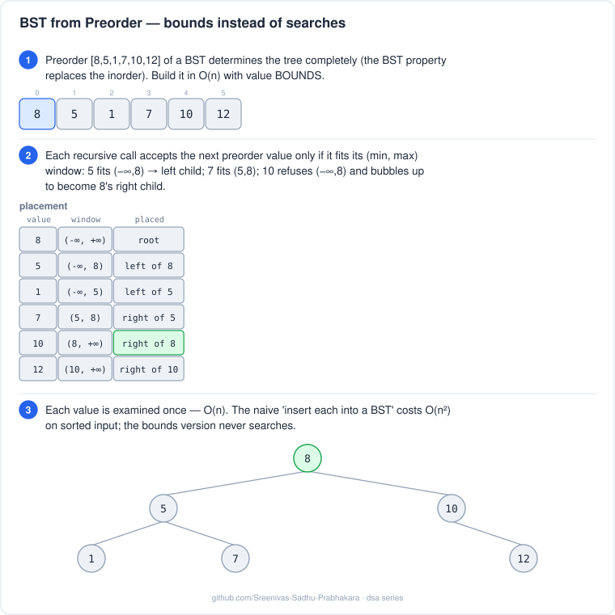

# BST from Preorder Traversal

> Striver SDE Sheet 134 · Day 20 BST — one cursor and an inherited upper bound; each call eats values while they're allowed, no inorder needed. Go, stdlib only, tested.

## Problem

Rebuild the unique BST whose preorder traversal is given — in O(n), without first sorting to get the inorder and running the general two-traversal construction (#125).

## Approach

A BST's ordering replaces the second traversal: once a node is placed, every value in its left subtree must be smaller, and any larger value must belong to some ancestor's right side. Encode that as an **upper bound** passed down the recursion: a call builds nodes from the cursor while the next value stays under its bound — the left child gets `node.Val` as its bound, the right child inherits the parent's. When the next preorder value exceeds the bound, this subtree is finished and the recursion returns, letting an ancestor claim the value. Each element is examined O(1) times. Degenerate inputs (sorted either way) build the expected chains — pinned by tests.

**Complexity:** O(n) time, O(h) recursion.

## Visual walkthrough

Read the picture top to bottom — each numbered frame is one moment of the algorithm
running on this repo's test example.

## Run

    go test ./...   # verify
    go run .        # demo

---

One of 191 repos solving Striver's SDE Sheet in Go — stdlib only, one problem per repo, every solution tested. Browse the set: [`dsa-*` repos](https://github.com/Sreenivas-Sadhu-Prabhakara?tab=repositories&q=dsa-&type=source).
